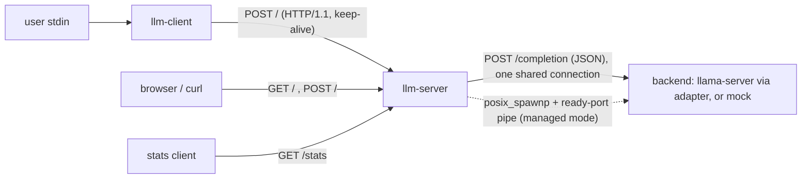
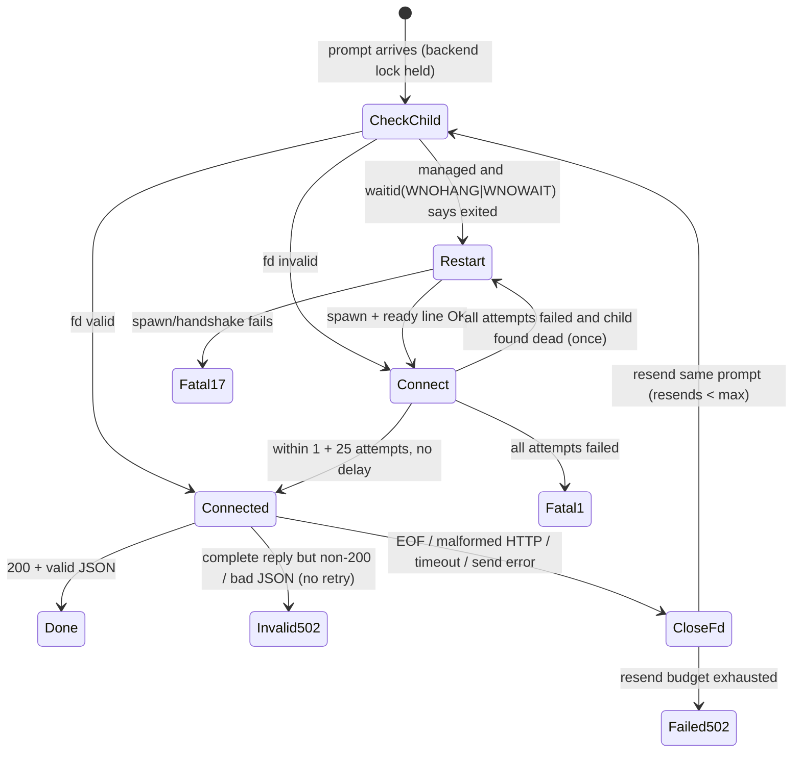

# Architecture

## Data flow

`llm-client` reads one line, sends it as `POST /` with the line plus `\n` as
the body, and waits for the complete reply before it reads the next line.
`llm-server` gives every accepted prompt connection its own handler thread
and its own history. Each prompt becomes a JSON `/completion` request on the
single shared backend connection.

## Modules

| File | Responsibility |
|---|---|
| `netio.c` | Loopback listen/connect, `poll()` deadlines, the stop-pipe wake-up, `send(MSG_NOSIGNAL)`, buffered `Reader` |
| `http.c` | Request and response head parsing, body read/discard, response and request serialisation |
| `json.c` | Escaping for the request body; validating parser that extracts the top-level `content` and `tokens_evaluated` |
| `history.c` | Per-connection ring of interaction blocks; builds the completion JSON |
| `backend.c` | Managed/external backend, spawn and handshake, reconnect/resend/restart policy |
| `server.c` | Listeners, slot gate, prompt/stats handlers, signal thread, shutdown |
| `workers.c` | Joinable handler threads plus a reaper thread |
| `stats.c` | Five counters under one mutex |
| `config.c`, `numparse.c` | CLI and `LLMGW_*` parsing |
| `client.c` | Interactive client |

## Threads

| Thread | Count | Blocks in |
|---|---|---|
| main | 1 | `poll(listen, stop)` while accepting prompt clients; `pthread_cond_wait` in the slot gate |
| signal | 1 | `sigwait({HUP, INT, TERM})` |
| reaper | 1 | `pthread_cond_wait`, then `pthread_join` on finished handlers |
| stats acceptor | 0 or 1 | `poll(statsListen, stop)` |
| prompt handler | 1 per accepted prompt client | `poll(client, stop)`, the backend lock, or backend I/O |
| stats handler | 1 per stats connection | `poll(client, stop)` |

`SIGHUP`, `SIGINT` and `SIGTERM` are blocked in `main` before any thread is
created, so every thread inherits the mask and only the signal thread
receives them. No asynchronous signal handler exists, and no thread calls
`printf` or takes a lock from signal context. `SIGPIPE` is ignored, and
socket writes use `MSG_NOSIGNAL` as well.

Every blocking wait is a `poll()` that also watches the read end of a **stop
pipe**. Shutdown writes one byte to that pipe and never drains it, so every
current and future waiter wakes. Nothing uses `pthread_cancel`, and no thread
closes a descriptor that another thread may still be using.

## Locks and ownership

| Lock | Protects | Held during I/O? |
|---|---|---|
| `Backend.lock` | backend fd, reader, child PID, port; restart and reconnect | **Yes.** It is held across one whole send+receive so requests never interleave. JSON parsing happens after it is released. |
| `Stats.lock` | the five counters | No. Only increments and one struct copy. This is a leaf lock. |
| `SlotGate.lock` | used/limit/closing | No |
| `Workers.lock` | active/done lists | No. Held across `pthread_create` so the new thread ID is stored before the thread can finish. |

Lock order: no lock is ever acquired while another is held. Tokens are added
to the stats only after `backend_complete` has released `Backend.lock`. If
nesting is ever introduced, the documented order is `Backend.lock` →
`Stats.lock`, and `Stats.lock` stays a leaf.

Ownership:

- The accept loop allocates a `ConnCtx` (fd, flags) and a `Worker`. If
  `pthread_create` fails, the accept loop frees both, closes the fd and
  releases the slot. Otherwise the handler owns the fd and closes it. The
  reaper frees `ConnCtx` and `Worker` after `pthread_join`.
- A `History` lives on the handler's stack and is touched only by that
  thread, so it needs no lock. `history_append` copies first and only then
  evicts, which makes it all-or-nothing.
- Strings and bodies are length-tracked (`Buf`, `bodyLen`). NUL bytes in
  prompts or content survive end to end. They are escaped as `\u0000` toward
  the backend.

## Prompt request lifecycle

1. Read the request head (method, target, headers). Malformed input, early
   EOF or a stop request closes the connection silently.
2. If the method is not GET/POST → 405. If the path is not `/` → 404. In both
   cases the body is drained first (up to 64 KiB, otherwise the reply carries
   `Connection: close`).
3. `GET /` reads the home page file on every request (at most 1 MiB).
4. `POST /`: increment *prompts received*. If `Content-Length` > 2048 → 413,
   checked before anything is allocated. Otherwise read the body, build the
   JSON (system block, stored blocks oldest first, current prompt, empty
   assistant prefix, `n_predict: 256`, `cache_prompt: false`) and call
   `backend_complete`.
5. On success: add `tokens_evaluated` to the stats, append the interaction to
   the history, and send `content + "\n"`. If sending to the client fails,
   the work is still counted.

## Backend recovery state machine

- **Connection failure vs. process death.** EOF on the socket never causes a
  restart by itself. A restart happens only after `waitid` reports that the
  owned child has exited. The child is checked with `WNOWAIT`, its process
  group (which includes anything it started, such as `llama-server`) is sent
  `SIGKILL`, and only then is it reaped. Signals therefore never reach a
  recycled PID.
- **Retries.** Every connect sequence makes one first attempt and up to 25
  immediate retries. Exhausting them is fatal: the gateway kills and reaps an
  owned child, prints the message, and exits with status 1. External backends
  are never signalled.
- **Resend budget.** This is new and not in the original design. A backend
  that accepts connections but keeps returning broken HTTP could otherwise
  cause an endless reconnect/resend loop. After `LLMGW_BACKEND_MAX_RESENDS`
  resends the client gets a 502 and the gateway keeps running.
- **Exactly-once is not guaranteed.** A resent prompt may already have been
  processed by the backend. A timed-out connection is closed rather than
  reused, so a late reply can never be matched to the wrong request.
- **Spawning in a threaded process.** `posix_spawnp` with file actions
  (stdin/stderr → `/dev/null`, stdout → the pipe), an empty signal mask,
  default dispositions for PIPE/HUP/INT/TERM and a new process group. Every
  gateway descriptor is `O_CLOEXEC`/`SOCK_CLOEXEC`, so the child inherits
  only the three it needs. No code runs between fork and exec.

## HTTP subset

Accepted: the request line `TOKEN SP target SP HTTP/1.0|HTTP/1.1` (target is
printable ASCII without spaces), CRLF line endings, header names that are
tokens, values without control characters, duplicate `Content-Length` only
if identical, and `Connection: close` / HTTP/1.0 meaning close after the
reply. Pipelined requests are handled in order.

Rejected as malformed (the connection is closed with no reply): bare LF, a
CR inside a line, obsolete line folding, a line longer than 8000 bytes, more
than 100 header fields or 32 KiB of headers, a non-digit or overflowing
`Content-Length`, conflicting `Content-Length` values, any
`Transfer-Encoding`, an unsupported version, and EOF in the middle of a
message.

Responses (client and backend side): status 200–599 only (1xx is rejected),
and `Content-Length` is required except for 204/304. Size caps are 16 MiB
for the client and 8 MiB from the backend.

## Graceful shutdown

On `SIGINT`/`SIGTERM` the signal thread writes to the stop pipe and closes the
slot gate. The rest of the sequence runs on the main thread:

1. The accept loops return, and the stats acceptor is joined.
2. Handlers wake from `poll`. A handler in the middle of a backend
   transaction gets `STOPPED` and closes its client without a reply. A
   handler waiting for the backend lock gets it, sees the stop flag, and
   leaves.
3. `workers_close` waits until no handler is active and the reaper has
   joined them all.
4. `backend_shutdown` closes the connection. In managed mode it sends
   `SIGTERM` to the child's process group, waits up to 2 s, sends `SIGKILL`,
   then reaps. External backends are left alone.
5. The signal thread is joined, descriptors are closed, and memory is freed.
   The exit status is 0.

Shutdown during backend startup works the same way: the ready-line wait also
watches the stop pipe.

Known limits: a client that sends a valid head and then stalls the body
keeps its handler until it disconnects or shutdown happens. Idle clients have
no timeout. Sends to clients have a 30 s deadline. If the gateway itself is
killed with `SIGKILL`, a managed backend is orphaned.
